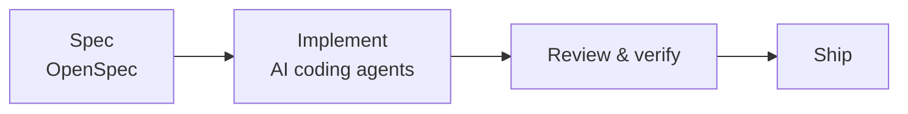

# Hi, I'm Ikhsan

Software engineer at PT Kreasindo Cipta Teknologi, based in Indonesia.
I write the spec, AI agents help write the code, and I verify it before it ships.

## How I work

## Stack

**Frontend:** TypeScript, React, Next.js, Angular, Tailwind CSS 
**Backend:** Go (Gin, Echo), Node.js, Django 
**Mobile & desktop:** Flutter, Rust with Tauri 
**Data & infra:** PostgreSQL, Redis, Docker 
**Workflow:** Camunda

## Currently

- API integrations and formal API documentation.
- Running parallel AI agent sessions in Orca.
- Building desktop apps with Rust and Tauri.

## Find me

Coding content on Instagram: [@ikhsan.code](https://www.instagram.com/ikhsan.code/)
